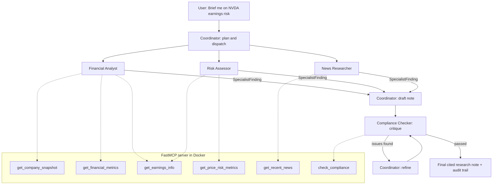

# Module 4 Capstone: Multi-Agent Investment Research System

**Learner role:** Multi-Agent Architect
**Demo question:** *"Brief me on NVDA earnings risk"* → a cited, compliance-checked research note

> New to this? Read **[LEARNING_GUIDE.md](LEARNING_GUIDE.md)** first. It explains every
> idea and every file in plain English.

---

## The problem

Investment-grade research involves several jobs: fetching news, analysing financials,
assessing risk, checking compliance and writing a recommendation. One agent that tries
to do all of it becomes a confused generalist. It is weak at each step and impossible
to audit.

## The solution

A **hierarchical multi-agent system**:

- A **Coordinator** decomposes the question and dispatches the work to specialists.
- The specialists are the **Financial Analyst**, **Risk Assessor**, **News Researcher**
  and **Compliance Checker**.
- Their tools live on a **custom MCP server** built with FastMCP and run in Docker.
- Each specialist returns a **structured message** (a Pydantic model).
- The Coordinator combines those messages into a brief.
- A **Research → Critique → Refine** loop improves the brief until it passes compliance.



## How each deliverable is met

| Deliverable | Where |
|---|---|
| FastMCP server with custom financial research tools, containerised with Docker | `mcp_server/`, `Dockerfile`, `docker-compose.yml` |
| Debugged with MCP Inspector | Step 3 of the quick start below |
| Multi-agent system: Coordinator + 4 specialists | `crewai_app/` (CrewAI) and `adk_app/` (Google ADK) |
| Coordinator-Dispatcher pattern | `crewai_app/coordinator.py` (rule-based) and `research_coordinator` in `adk_app/.../agent.py` (LLM-based) |
| Research → Critique → Refine | `crewai_app/main.py` (loop) and `LoopAgent` in `adk_app/.../agent.py` |
| Structured messages | `shared/messages.py` |
| Visual workflow in Flowise | `visual_workflow/FLOWISE_BUILD_GUIDE.md`; export your flow into this folder |
| End-to-end demo with a cited note | `python -m crewai_app.main "Brief me on NVDA earnings risk"`, output saved in `outputs/` |

## Project structure

```
multi-agent-research-capstone/
├── mcp_server/            # The MCP server (the "toolbox")
│   ├── server.py          #   FastMCP tool definitions
│   ├── data_sources.py    #   Yahoo Finance data, with a labelled sample-data fallback
│   └── compliance_rules.py#   Rule-based compliance checks
├── shared/                # Used by both agent versions
│   ├── config.py          #   Settings from .env
│   └── messages.py        #   Structured message formats (Pydantic)
├── crewai_app/            # Code-first version 1: CrewAI
│   ├── coordinator.py     #   Dispatcher: picks the specialists
│   ├── agents.py          #   The 5 agents and their allowed tools
│   ├── tasks.py           #   Work orders: research, draft, critique, refine
│   └── main.py            #   Runs everything end to end
├── adk_app/research_coordinator/   # Code-first version 2: Google ADK
│   └── agent.py           #   Same system; the LLM coordinator routes the work
├── visual_workflow/       # Flowise build guide (+ your exported JSON)
├── scripts/check_mcp_server.py     # Tests the server without an LLM
├── tests/                 # Automatic tests (pytest), no API key needed
├── outputs/               # Research notes and audit trails are saved here
├── Dockerfile, docker-compose.yml
├── requirements.txt, requirements-mcp.txt
└── .env.example           # Copy to .env and add your API key
```

## Quick start

You need Python 3.11 or newer, Docker Desktop and Node.js 18 or newer (for MCP
Inspector and Flowise). You also need a free Gemini API key from
https://aistudio.google.com/apikey.

```bash
# 1. Set up (inside the project folder, in the VS Code terminal)
python -m venv .venv
source .venv/bin/activate            # Windows: .venv\Scripts\activate
pip install -r requirements.txt
cp .env.example .env                 # Windows: copy .env.example .env, then add your key

# 2. Start the MCP server in Docker (leave this terminal running)
docker compose up --build

# 3. Debug with MCP Inspector (new terminal)
npx @modelcontextprotocol/inspector
#    In the browser: Transport = Streamable HTTP, URL = http://localhost:8000/mcp, then Connect
#    Open the Tools tab, select a tool, enter a ticker and click Run Tool

# 4. Quick check without an LLM
python scripts/check_mcp_server.py NVDA

# 5. Run the tests
pytest -v

# 6. The end-to-end demo (CrewAI)
python -m crewai_app.main "Brief me on NVDA earnings risk"

# 7. The Google ADK version
cd adk_app && adk web --port 8080
#    Open http://localhost:8080, choose research_coordinator and ask the same question
```

## Design decisions (worth discussing in your write-up)

1. **Least privilege.** Each agent can only see its own tools. For example, the News
   Researcher cannot run compliance checks.
2. **Deterministic guardrails plus LLM judgement.** The compliance checks are fixed
   Python rules, so they always give the same answer. The LLM critic adds judgement
   on top. A final rule-only gate runs after the loop.
3. **Auditability.** Every run saves `*_trace.json`. It holds the dispatch plan, each
   specialist's structured finding, every critique round and the final gate result.
4. **Honest data.** If live data is unavailable, the tools return sample data. Sample
   data is labelled `data_mode: "sample"` and disclosed in the note.
5. **Two routing styles.** CrewAI uses a rule-based dispatcher: cheap, predictable and
   testable. ADK lets the LLM route: more flexible, less predictable. Same MCP tools.
6. **A bounded loop.** Critique → Refine runs at most `MAX_REFINE_ROUNDS` times, so a
   disagreement between agents can't loop forever or run up costs.

## Limitations and next steps

- Yahoo Finance data is unofficial and may be delayed. A production system would
  use a licensed data feed.
- The compliance rules are a teaching example, not a complete regulatory rulebook.
- Possible extensions: run the specialists in parallel (ADK `ParallelAgent`), add a
  SEC-filings tool, add a human approval step before publishing, and track token cost
  per run.

*This project is for educational purposes only and is not investment advice.*
